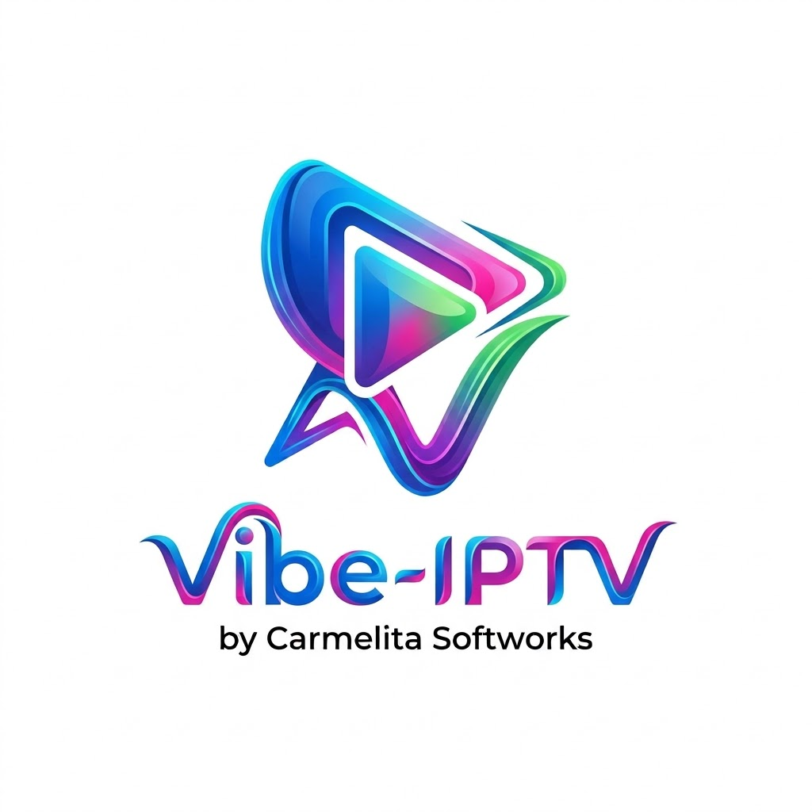
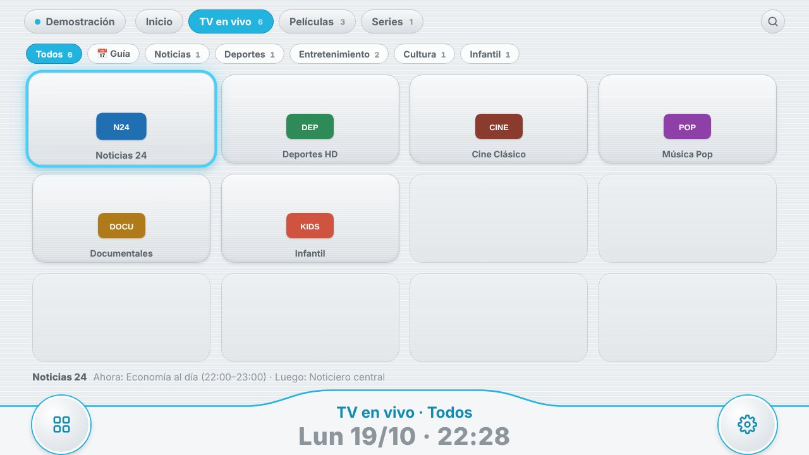
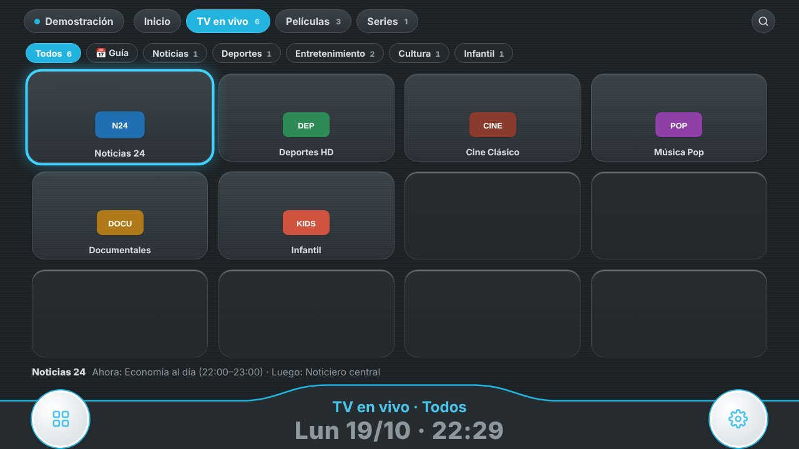
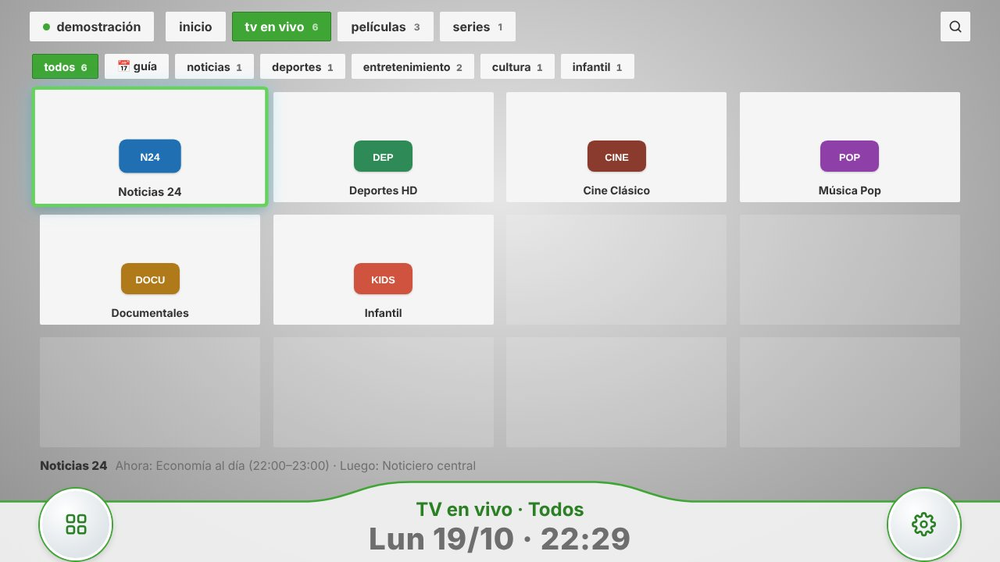
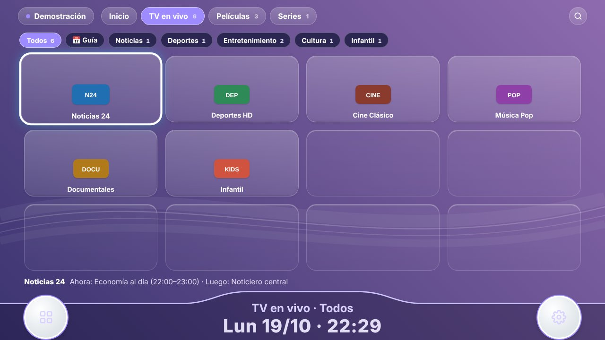
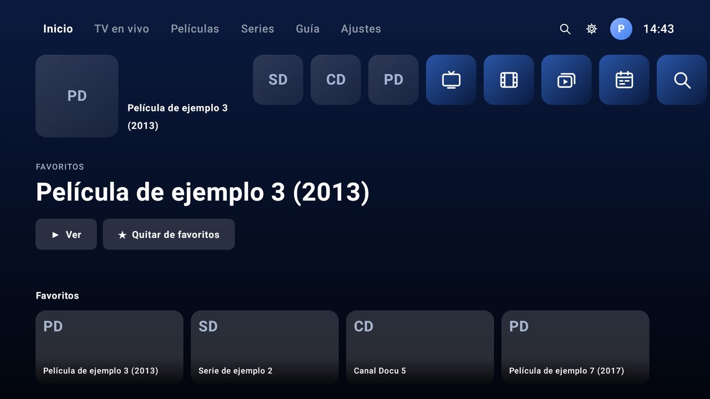
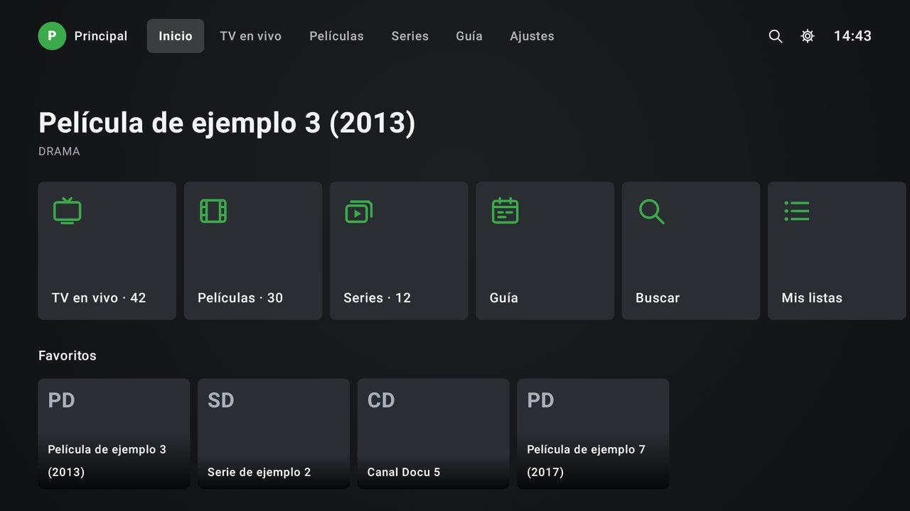
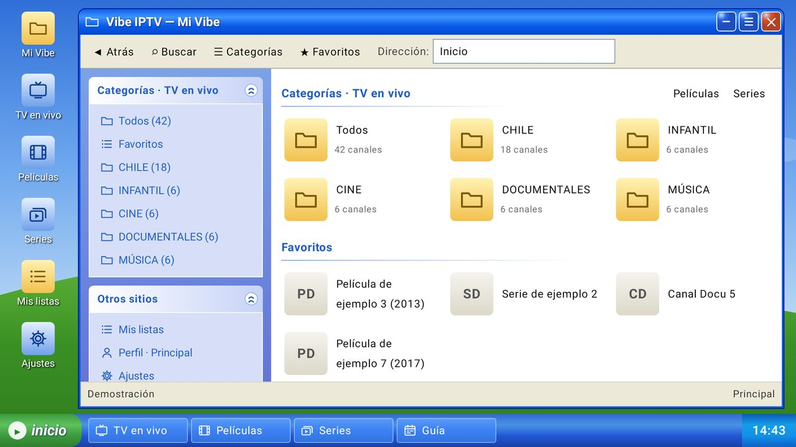
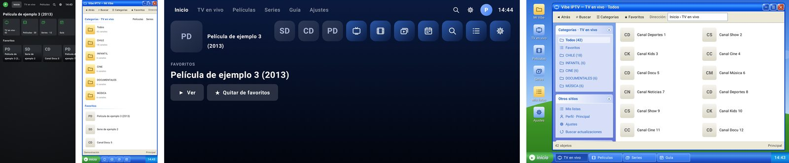

<div align="center">



# Vibe IPTV

**Tu propio reproductor IPTV, libre y de código abierto, para navegador, Android y Android TV.**

Listas M3U/M3U8 · Xtream Codes · Guía XMLTV · Pensado para el control remoto

🇨🇱 **Español** · 🇬🇧 [English](README.en.md)


</div>

---

**Vibe IPTV** es un proyecto de **Carmelita Softworks**, **libre y de código abierto** (licencia **GPLv3**) con dos apps
nativas que comparten la misma idea: una **app web instalable (PWA)** que funciona en cualquier
navegador, y una **app nativa para Android y Android TV** escrita en Kotlin con Jetpack Compose.
Tiene un menú de canales en mosaico, ajustes ordenados por secciones y **tres motores de
reproducción** (ExoPlayer, VLC y MPV) para que los canales difíciles de la TV de cable también se vean.

Todo el código está a la vista: puedes revisarlo, compilarlo tú mismo, modificarlo y compartirlo.

> [!IMPORTANT]
> **Es solo un reproductor.** No incluye, vende ni recomienda canales, listas ni transmisiones.
> Tú agregas tu propia lista M3U o tu cuenta Xtream Codes de un proveedor legítimo.

📖 **¿Primera vez?** La [Guía de uso](docs/GUIA.md) explica paso a paso cómo instalar, agregar listas, configurar la guía y usar los subtítulos.

🖥️ **¿Tienes un servidor propio?** (NAS, Raspberry Pi, mini PC, VPS, Tvheadend…) Sigue la guía [Instalar en tu propio servidor](docs/SERVIDOR-PROPIO.md), con Docker, servicio de Linux o Windows.

---

## ✨ Funciones

### ▶️ Reproducción
- **Tres motores en Android** que se relevan solos: ExoPlayer (Media3) → **VLC** (LibVLC) → **MPV** (libmpv). Si uno no puede con un canal, prueba el siguiente; también puedes elegir uno fijo en Ajustes.
- **Formatos de la TV de cable**: video MPEG-2 entrelazado y audio AC-3 / E-AC-3 / MP2, con desentrelazado automático.
- **En el navegador**: hls.js y mpegts.js, y si el navegador no soporta el formato, conversión al vuelo con **ffmpeg** a través del servidor local.
- **Se configura sola según el equipo**: al iniciar detecta memoria, procesador y decodificadores. En TV boxes modestos (Xiaomi Mi Box / Mi TV Stick, equipos de 1–2 GB) activa el **modo liviano**: menús sin sombras ni animaciones, carátulas con menos memoria y video más liviano.
- **Seguir viendo en el inicio**: tus películas y series a medias, con su barra de avance.
- **Búfer ajustable** (Rápido / Equilibrado / Estable) en los tres motores, y **búfer aprendido**: si un canal se corta seguido, la app le sube el búfer sola y lo recuerda.
- **Canales en vivo estables**: sin saltos hacia adelante ni parpadeos, con reconexión automática si la señal se corta.
- **Colchón en vivo**: cuando un canal en vivo queda con poca reserva, se reproduce un poco más lento (no se nota) hasta rehacerla; y si la conexión se cae un momento, reconecta enseguida sin vaciar lo ya cargado. En *Información técnica* se ven la reserva guardada, los cortes, las reconexiones y la velocidad de descarga.
- Menú del reproductor con pistas de audio, calidad, relación de aspecto, velocidad, información técnica del canal, favoritos, imagen en imagen (PiP) y lista de canales sin salir del video.

### 🧭 Navegación
- **Menú en mosaico** grande y claro, cómodo de usar con el control remoto (D-pad) en Android TV.
- Secciones **TV en vivo**, **Películas** y **Series**, con **categorías y subcategorías** tomadas de tu lista.
- Series agrupadas por temporada y episodio, y **Seguir viendo**: películas y series continúan donde quedaste.
- **Búsqueda** y **favoritos**.
- Pantalla de inicio animada con el estilo del menú y pantalla de bienvenida para agregar tu primera lista en segundos.
- En Android se abre **en horizontal** por defecto, como un TV.

### 🗂️ Listas y guía (EPG)
- **Listas M3U / M3U8** desde URL o archivo, y **cuentas Xtream Codes** (con detección automática de puertos y formatos).
- **Desde una captura de pantalla**: sube la foto o captura del mensaje de tu proveedor y el servidor, usuario, contraseña, enlace M3U y guía se rellenan solos. La lectura se hace en tu equipo (ML Kit en Android, Tesseract.js en la web): la imagen no se envía a ningún servidor.
- **Varias listas guardadas** y cambio rápido entre ellas.
- **Guía de programación XMLTV** (también comprimida en .gz) que se **actualiza sola** al agregar una lista y al abrir la app. Admite varias guías combinadas y ajuste de horario.
- **Guía en grilla** (Android y web): canales y programas en una línea de tiempo, navegable con el control.
- **TV en diferido** (catch-up de Xtream): los programas ya emitidos se ven desde el inicio, si tu cuenta lo permite.
- Compatible con guías generadas con el proyecto libre [iptv-org/epg](https://github.com/iptv-org/epg).

### 💬 Subtítulos
- Búsqueda en **varias fuentes a la vez**: OpenSubtitles (la misma base que el complemento **VLSub** de VLC), SubDL y Podnapisi.
- **Subtítulos con IA sin internet** (Android): transcribe en vivo el audio en español, inglés o portugués con [Vosk](https://alphacephei.com/vosk) (código abierto). La versión **IA** (`vibe-iptv-ia-*.apk`) trae el modelo de español incluido; la normal lo descarga la primera vez (~40 MB).
- **Subtítulos automáticos** (activado por defecto): en películas y series, si el audio no está en tu idioma, usa la pista interna o busca y carga uno solo desde OpenSubtitles y Podnapisi, **sin clave ni cuenta**.
- **SubDL integrado con su API oficial**: busca por código IMDb, baja sólo el episodio de los paquetes de temporada, marca los subtítulos SDH y permite **probar la clave** en Ajustes.
- Abre archivos `.zip`, corrige acentos de los `.srt` en español (Windows-1252), convierte `.ass` y permite **adelantar o atrasar** el subtítulo.

### 🎨 Apariencia y ajustes
- Ajustes por secciones (rápidos, listas y guía, apariencia, reproducción, subtítulos, red, inicio, datos).
- Tema claro (predeterminado), oscuro o del sistema, con colores de acento.
- Al abrir la app puede volver directamente al último canal visto.
- **Temas**: Claro, Oscuro, **Mosaicos** (gris y verde, esquinas rectas), **Ondas** (violeta) y **Personalizado** (colores, imagen de fondo, mosaicos translúcidos), que se puede exportar e importar para compartirlo.
- **Temas estilo consola y escritorio** (Android): **Pulso** (fila de íconos, el elegido grande y su imagen de fondo, en azul), **Horizonte** (destacado grande y filas de mosaicos con borde blanco, en verde) y **Escritorio** (ventana azul de principios de los 2000, íconos de escritorio, categorías en el panel y barra de tareas con botón de inicio). Diseño propio: sin logos ni recursos de ninguna marca.
- **Se adaptan a cada equipo**: TV, teléfono (vertical u horizontal), tableta y laptop; en pantallas grandes todo se agranda en proporción.
- **En español y en inglés**: sigue el idioma del equipo o se elige en Ajustes → Apariencia → Idioma.

### 🔒 Privacidad
- **Sin cuentas, sin anuncios y sin telemetría.** Tus listas, favoritos y ajustes se guardan solo en tu equipo ([política de privacidad](PRIVACIDAD.md)).
- **Control parental:** con un PIN, las categorías para adultos quedan ocultas.
- **Perfiles** (Android): favoritos y «Seguir viendo» por persona; el perfil infantil nunca muestra contenido para adultos.
- **Grabación** (Android): botón ● en el reproductor para guardar un canal en vivo en *Descargas/VibeIPTV*.
- **Tamaño de los controles del reproductor** ajustable (Ajustes → Reproducción).
- **Control remoto completo**: teclas numéricas para ir a un canal, **canal anterior**, y temporizador para dormir (15 a 120 min).
- **Mini reproductor en TV**: el video sigue en una esquina mientras recorres el menú o la guía.
- **Multivista**: hasta 4 canales a la vez; suena el que elijas.
- **Vistos recientemente**, **buscar un programa en la guía** por su nombre y **organizar categorías** (ocultar y ordenar).
- **Fila en el inicio de Android TV / Google TV** con tus favoritos y canales recientes.
- **Doble toque** a la izquierda o derecha para retroceder o adelantar 10 s (celulares).
- **Enviar registro** (Ajustes → Acerca de) para reportar problemas, sin usuarios ni contraseñas.
- **Respaldo**: exporta e importa listas, favoritos, «Seguir viendo» y ajustes en un archivo, por ejemplo al cambiar de TV.
- Las contraseñas de Xtream se ocultan en mensajes de error y registros.

---

## 🖼️ Capturas

### Temas

| Claro | Oscuro |
|---|---|
|  |  |
| **Mosaicos** | **Ondas** |
|  |  |

<sub>Capturas de la versión web con la lista de demostración. En Android además está el tema **Personalizado** (colores, imagen de fondo y mosaicos translúcidos).</sub>

### Temas estilo consola y escritorio (Android)

| Pulso | Horizonte |
|---|---|
|  |  |
| **Escritorio** | |
|  | |

**En cada equipo** — teléfono vertical, teléfono horizontal y tableta:



<sub>Capturas de la app Android con la lista de demostración (sin imágenes de canales ni películas). Todas las pantallas de cada tema y equipo están en la rama [`capturas`](../../tree/capturas).</sub>

---

## 📥 Instalación

### Android / Android TV

**📺 En el TV con Downloader** (Android TV, Google TV, Fire TV, TV Box): instala la app *Downloader*,
permítele instalar apps desconocidas y escribe el código:

<div align="center">

## **9370754**

o la dirección `carmelitasoftworks.github.io/Vibe-IPTV/tv`

</div>

Paso a paso para cada tipo de TV y solución de problemas: **[docs/DOWNLOADER.md](docs/DOWNLOADER.md)**.

**📱 En el celular:** abre **[carmelitasoftworks.github.io/Vibe-IPTV](https://carmelitasoftworks.github.io/Vibe-IPTV/)** y toca *Celular o tablet*,
o descarga el APK desde **[Releases → versión de prueba](../../releases/tag/prueba)**:

| Archivo | Para | Enlace corto |
|---|---|---|
| `vibe-iptv-armv7.apk` | Casi todos los TV, Fire TV y TV Box | `…/Vibe-IPTV/tv` |
| `vibe-iptv-arm64.apk` | Celulares, tablets y TV Box de 64 bits | `…/Vibe-IPTV/movil` |
| `vibe-iptv-x86_64.apk` | Emuladores y algunos Chromebook | — |
| `vibe-iptv-universal.apk` | Si no sabes cuál elegir (pesa más) | `…/Vibe-IPTV/universal` |

Al instalar, permite **“Instalar apps desconocidas”**. Requiere **Android 7.0 (API 24)** o superior (el motor MPV, desde Android 8.0).
Para actualizar, instala la nueva versión encima: se conservan tus listas y ajustes.

### Navegador (PC, Mac, celular)
1. Descarga el repositorio (**Code → Download ZIP**) y descomprímelo.
2. Instala [Node.js](https://nodejs.org) (versión 18 o superior).
3. En Windows, haz doble clic en `web/iniciar.bat`. En otros sistemas: `cd web && npm install && node server/server.js --open`.
4. Para usarlo desde el celular o el TV de tu casa, usa `web/iniciar-red-local.bat` (o `--lan`).
5. Desde el navegador puedes **instalarla como app (PWA)**.

### 📱 iPhone y iPad

La versión web funciona en Safari y se puede **agregar a la pantalla de inicio** como una app:

1. En un PC, Mac, NAS o Raspberry Pi de tu casa, inicia el servidor para la red local: `web/iniciar-red-local.bat` en Windows, o `HOST=0.0.0.0 node server/server.js` (también con Docker).
2. En el iPhone, abre en Safari la dirección que muestra el servidor (por ejemplo `http://192.168.1.20:8080`).
3. Toca **Compartir → Agregar a inicio**. Se abre a pantalla completa, con su ícono.

En iPhone, Safari no reproduce canales MPEG-TS directamente: la app usa primero la versión HLS del canal (`.m3u8`) y, si no existe, el servidor lo convierte a HLS con **ffmpeg** (incluido con `npm install`). Funcionan la imagen en imagen y AirPlay. Si el video empieza en silencio, toca la pantalla una vez para activar el sonido (es una regla de iOS).

Para usarla fuera de casa, publica el servidor con HTTPS (por ejemplo, un túnel de Cloudflare) y **siempre con contraseña** (`VIBE_PASSWORD`). Ver [Instalar en tu propio servidor](docs/SERVIDOR-PROPIO.md).

### Servidor propio (Docker, Linux, Raspberry Pi, NAS)
```bash
git clone https://github.com/CarmelitaSoftworks/Vibe-IPTV.git
cd Vibe-IPTV/web
docker compose up -d        # http://IP-DEL-SERVIDOR:8080
```
Instalación como servicio, contraseña de acceso (`VIBE_PASSWORD`), HTTPS y cómo conectar Tvheadend,
Threadfin o xTeVe: **[docs/SERVIDOR-PROPIO.md](docs/SERVIDOR-PROPIO.md)**.

---

## 🛠️ Compilar desde el código

### En la nube (sin instalar nada)
Cada cambio en la rama `main` compila el APK automáticamente con **GitHub Actions**
([`compilar-apk.yml`](.github/workflows/compilar-apk.yml)). También puedes lanzarlo a mano desde
**Actions → Compilar APK → Run workflow**. El APK se publica en **Releases → versión de prueba**, y si algo
falla el registro completo queda en la rama `build-logs`.

### En tu computador
```bash
cd android
./gradlew assembleDebug
# APKs en android/app/build/outputs/apk/debug/
```
Necesitas JDK 17 y el SDK de Android (o simplemente abre la carpeta `android/` en Android Studio).

### Pruebas de la app web
```bash
cd web
npm test
```

---

## 🧱 Tecnologías

| Parte | Tecnología |
|---|---|
| Android | Kotlin 2.1, Jetpack Compose, Gradle 8.13 / AGP 8.11, SDK 36 |
| Reproducción Android | Media3 ExoPlayer, LibVLC, libmpv |
| Red e imágenes | OkHttp, Coil |
| Lectura de capturas | ML Kit Text Recognition (Android), Tesseract.js (web) |
| Web | JavaScript (módulos ES) sin frameworks, PWA |
| Reproducción web | hls.js, mpegts.js, ffmpeg (opcional, vía `ffmpeg-static`) |
| Servidor local | Node.js sin dependencias obligatorias (proxy, conversión y subtítulos) |

### Estructura del proyecto
```
android/   App nativa para Android y Android TV (Kotlin + Compose)
web/       App web / PWA, servidor local en Node.js y archivos Docker
web/deploy Ejemplos de servicio systemd, Caddy y nginx
docs/      Guía de uso e instalación en servidor propio (español e inglés)
i18n/      Diccionario español → inglés compartido por la web y Android
.github/   Compilación automática del APK
```

---

## 🤝 Contribuir

¡Las contribuciones son bienvenidas! Abre un **issue** para reportar errores o proponer ideas, o envía
un **pull request** con tus mejoras. Te pedimos mantener el enfoque del proyecto: **un reproductor
neutral, sin contenido incluido** (no se aceptan listas, enlaces a canales ni credenciales).

Al reportar un problema con un canal, **no publiques tu usuario, contraseña ni la URL completa de tu lista**.

Guía para contribuir: [CONTRIBUTING.md](CONTRIBUTING.md) · Seguridad: [SECURITY.md](SECURITY.md) · Privacidad: [PRIVACIDAD.md](PRIVACIDAD.md) · Firma de los APK: [docs/FIRMA.md](docs/FIRMA.md)

**Traducciones:** los textos en inglés están en [`i18n/en.json`](i18n/en.json). Corrige o agrega una frase ahí y
ejecuta `node i18n/build.mjs` para actualizar la web y Android.

---

## 🙏 Créditos

**Vibe IPTV** es desarrollado y mantenido por **[Carmelita Softworks](https://github.com/CarmelitaSoftworks)**. 🇨🇱
Es un proyecto *vibe coded* ([cómo se hizo](CREDITOS.md#hecho-con-vibe-coding)).

Y existe gracias a estos proyectos de código abierto y servicios:

- **🎬 Reproducción:** ▶️ [ExoPlayer (Media3)](https://github.com/androidx/media) · 🔶 [LibVLC](https://code.videolan.org/videolan/vlc) · 🎞️ [mpv / libmpv](https://github.com/jarnedemeulemeester/libmpv-android) · 🧩 [FFmpeg](https://ffmpeg.org) · 🔊 [Decodificador FFmpeg de Jellyfin](https://github.com/jellyfin/jellyfin-androidx-media) · 🌐 [hls.js](https://github.com/video-dev/hls.js) · 📡 [mpegts.js](https://github.com/xqq/mpegts.js)
- **💬 Subtítulos e IA:** 🎙️ [Vosk](https://alphacephei.com/vosk) · 🔗 [JNA](https://github.com/java-native-access/jna) · 🧠 [whisper.cpp](https://github.com/ggml-org/whisper.cpp) · ⚙️ [ggml](https://github.com/ggml-org/ggml) · 🗣️ [Modelo Whisper (OpenAI)](https://github.com/openai/whisper) · 📷 [ML Kit](https://developers.google.com/ml-kit) · 🔍 [Tesseract.js](https://github.com/naptha/tesseract.js) · 📝 [OpenSubtitles](https://www.opensubtitles.org) · 📝 [SubDL](https://subdl.com) · 📝 [Podnapisi](https://www.podnapisi.net)
- **📺 Guía y listas:** 🗓️ [iptv-org/epg](https://github.com/iptv-org/epg) · 📥 [OkHttp](https://github.com/square/okhttp)
- **🎨 Interfaz:** 🟣 [Kotlin](https://kotlinlang.org) · 🧱 [Jetpack Compose](https://developer.android.com/compose) · 🔄 [kotlinx.coroutines](https://github.com/Kotlin/kotlinx.coroutines) · 🖼️ [Coil](https://github.com/coil-kt/coil) · 💡 [OwnTV (inspiración de diseño)](https://github.com/ahXN00/OwnTV)
- **🧪 Pruebas:** 🤖 [Robolectric](https://github.com/robolectric/robolectric) · 📸 [Roborazzi](https://github.com/takahirom/roborazzi)

Licencias y para qué se usa cada uno: [CREDITOS.md](CREDITOS.md). Los nombres y marcas pertenecen a sus dueños; este proyecto no está afiliado a ellos.

---

## ⚖️ Aviso legal

Vibe IPTV es **únicamente un reproductor multimedia**. No aloja, distribuye ni proporciona
canales, listas ni contenido de ningún tipo. Cada usuario es responsable de las fuentes que
agrega y de contar con los derechos para verlas.

---

## 📄 Licencia

Copyright © 2026 Carmelita Softworks.

Distribuido bajo la **[Licencia Pública General de GNU, versión 3 (GPLv3)](LICENSE)**.

Puedes usar, estudiar, modificar y compartir este software libremente. Si distribuyes una versión
modificada, debe mantenerse bajo **GPLv3** y con su **código fuente disponible**.

---

<div align="center">

**Libre · Código abierto · Solo reproductor · Hecho con ❤️ por Carmelita Softworks**

</div>
